# Arista EVPN/VXLAN lab

A six-switch Containerlab fabric with eBGP underlay and EVPN overlay.
Four Linux clients share one L2 VXLAN service across the leaves.

Live validation passed in Ubuntu with `make verify`, including EVPN routes and
full-size client pings. See [verification](docs/verification.md) for the recorded
environment and checks. No Arista software is included.

## Architecture



Each leaf connects Ethernet3 to its matching Linux client (`client01`–`client04`).

Every leaf connects to both spines over routed /31 links. Each switch advertises
Loopback0 for BGP peering. Leaves also advertise Loopback1 for VXLAN transport.

| Component | Current implementation |
| --- | --- |
| Nodes | Two spines, four leaves, four Linux test clients |
| Underlay | Eight IPv4 eBGP sessions - leaf ECMP to remote loopbacks/VTEPs |
| Overlay | Eight loopback-based eBGP EVPN sessions - spines preserve VTEP next hops |
| L2 service | VLAN 10 / VNI 10010, RT `65000:10010`, clients in `10.10.10.0/24` |
| Management | Docker network `172.30.100.0/24` - CLI access via Docker |
| Images | Imported `ceos:4.36.2F`, locally built `evpn-client:alpine3.23.6` |
| Verification | Underlay, EVPN peers, VTEPs, Type 2/3 routes, full-size client pings |

Both spines use ASN 65000, so they do not learn each other's loopbacks through
leaves. See [architecture](docs/architecture.md) and [addressing](docs/addressing.md).

## Running the lab

The documented environment is Windows → VMware Workstation → Ubuntu VM →
Docker Engine → Containerlab → cEOS.

Follow [setup and daily operation](docs/setup.md) to prepare the VM and tools.

Once setup is complete, run from the repository root **inside Ubuntu**:

```bash
make clients    # Build once - downloads Alpine and networking tools.
make deploy
make inspect
# Wait for EOS to boot and BGP to converge.
make verify
```

### Switch and client access

Run these commands in Ubuntu. For a switch CLI, replace `<node>` with
`spine01`, `spine02`, or `leaf01`–`leaf04`:

```bash
sudo docker exec -it clab-evpn-<node> Cli
```

Use `enable` for privileged EOS commands.

For an Alpine Linux client shell, replace `<client>` with `client01` through `client04`:

```bash
sudo docker exec -it clab-evpn-<client> sh
```

Client `eth0` is management. Use `eth1` for fabric traffic.
Run `exit` to leave a CLI or shell - the container keeps running.

[Verification](docs/verification.md) describes expected results and manual checks.
`make destroy` removes the deployed lab while retaining saved configuration
files. Read [configuration persistence](docs/setup.md#configuration-persistence)
before changing or resetting a lab.

## Repository layout

```text
lab/evpn.clab.yml       Nodes, image tag, management network, and links
lab/configs/*.cfg      Six explicit EOS startup configurations
lab/clients/          Linux test client image and interface setup
docs/architecture.md   Routing design and limitations
docs/addressing.md     Interface, loopback, and ASN tables
docs/setup.md          Installation, access, and lab lifecycle
docs/verification.md   Acceptance checks and troubleshooting
scripts/              Deployment, teardown, and verification scripts
Makefile              Build, deploy, inspect, and verification shortcuts
```

## Scope and limitations

The lab bridges one subnet across all four leaves. There are no tenant
VRFs, routed gateways, L3 VNIs, or leaf redundancy configuration.
Verification covers reachability and installed routes. It does not measure
performance, traffic distribution, or failover. Other EOS releases may require
changes to CLI output parsing.

## License

[MIT](LICENSE) covers this repository's original configurations, scripts, and
documentation. Arista EOS/cEOS remains separately licensed by Arista and is not
distributed here.
